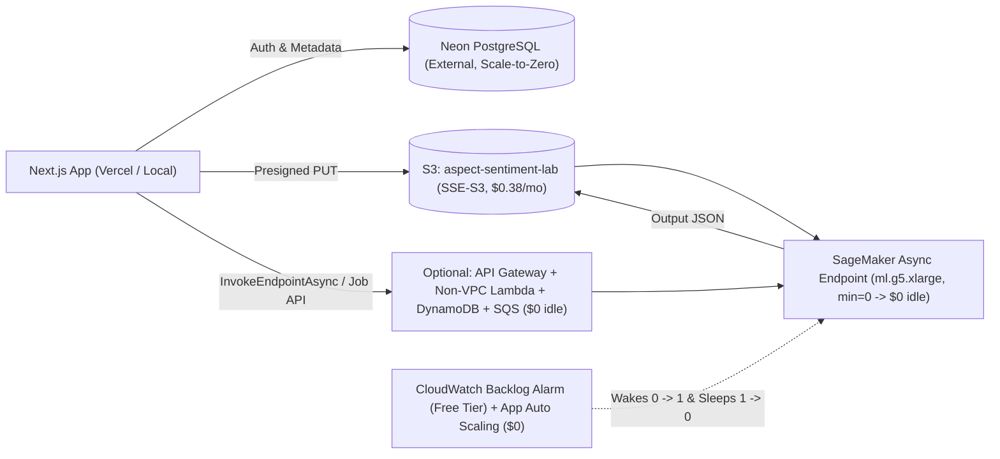

# Complete AWS Idle-Cost & Zero-Burn Report: VideoSaaS (`ap-southeast-2`)

## Executive Summary

Not every AWS service in the VideoSaaS codebase stops billing when traffic drops to zero. While many serverless components naturally drop to **\$0.00/month** at zero traffic, several services in the repository's optional CDK stack (`services/inference/monitoring/`) carry **fixed hourly or monthly minimums** that burn credits even with zero users.

All rates below use verified **Asia Pacific (Sydney / `ap-southeast-2`)** public USD pricing from [sydney-unit-rates.csv](file:///c:/Users/aamod/OneDrive/Desktop/Apps/VideoSaaS/docs/reports/aws-cost-2026-11-15/sydney-unit-rates.csv) normalized to a **730-hour month**.

### Monthly Idle Cost Comparison (At Zero Traffic)

| Architecture Profile | Monthly Idle Cost (730 hrs) | Free Plan Compatible? | Live Inference Ready? |
| :--- | ---: | :--- | :--- |
| **Previous Setup** (Real-time `ml.g5.xlarge` running + storage) | **\$1,337.83 / mo** | Burns credits in ~17 hrs | Yes (instant) |
| **Full Optional CDK Core** (`ENABLE_DATA_ARCHITECTURE=1`, 0 GPUs) | **\$265.79 / mo** | Partial (Firehose/Transcribe/GuardDuty blocked) | Yes (cold start) |
| **Current State** (Post-15 Nov cleanup, no endpoint) | **\$1.05 / mo** | Yes | No |
| **Recommended Zero-Idle Async Stack** (Async GPU `min=0` + serverless) | **\$1.05 / mo** *(or **\$0.38** without Studio disk)* | **Yes (100%)** | **Yes (auto-wakes)** |

---

## Tier 1: High-Burn Always-On Services (Fixed Hourly / Monthly Floors)

These services **continuously bill while idle** if deployed with the repository's current defaults.

| AWS Service | Idle Burn (Sydney / 730-hr mo) | Why It Burns When Idle | Can It Scale to \$0? | How to Eliminate Idle Burn | Free Plan? |
| :--- | ---: | :--- | :--- | :--- | :--- |
| **SageMaker Real-Time Endpoint** (`ml.g5.xlarge`) | **\$1,336.78** (\$1.8312/hr) | Requires ≥ 1 provisioned GPU instance 24/7. | **No** | Replace with **SageMaker Async Inference (`min_capacity=0`)** or create/delete on demand. | Yes (uses credits) |
| **Aurora PostgreSQL Serverless v2** (Writer + Reader) | **\$146.00** (\$0.20/ACU-hr × 2 × 0.5 ACU) | [data_architecture.py](file:///c:/Users/aamod/OneDrive/Desktop/Apps/VideoSaaS/services/inference/monitoring/data_architecture.py#L108-L114) sets `min_capacity=0.5` ACU on both writer and reader (1.0 ACU floor). | **Yes** *(with change)* | Use your existing **Neon PostgreSQL** (scales to zero externally), OR switch Aurora to a single writer with `min_capacity=0` (auto-pause). | Yes |
| **VPC Interface Endpoints (PrivateLink)** (4 services × 2 AZs) | **\$75.92** (8 × \$0.013/hr) | Bills per ENI per AZ per hour regardless of traffic (`Secrets`, `SQS`, `SageMakerRuntime`, `RDS Data`). | **No** | **Keep Lambdas outside a private VPC.** Standard Lambdas call S3, DynamoDB, SQS, and SageMaker over AWS endpoints for **\$0/hr**. *(S3 & DynamoDB Gateway Endpoints are always \$0/hr.)* | Yes |
| **Amazon RDS Proxy** | **\$18.25** (\$0.025/ACU-hr × 1.0 ACU) | Bills hourly against underlying Aurora capacity (plus AWS minimum vCPU/ACU rules). | **No** | Omit RDS Proxy; keep Neon Postgres or use **RDS Data API** (strictly pay-per-request). | Yes |
| **AWS KMS Customer Managed Keys** (16 CMKs) | **\$16.00** (16 × \$1.00/key) | [data_architecture.py](file:///c:/Users/aamod/OneDrive/Desktop/Apps/VideoSaaS/services/inference/monitoring/data_architecture.py#L59-L60) creates a separate CMK for every bucket, table, queue, topic, and secret. | **No** | Use **AWS-managed / SSE-S3 encryption** (**\$0.00/mo** key fee), or share 1 single CMK (**\$1.00/mo**) if CMK is required. | Yes |
| **Amazon ElastiCache (Valkey Serverless)** | **\$7.37** (0.1 GB × \$0.101/GB-hr) | Enforces a **100 MB minimum storage floor** billed 24/7 even when empty. | **No** | Omit Valkey; your app already falls back to **DynamoDB On-Demand** for quotas/rate limits at **\$0 idle**. | Yes |

> [!WARNING]
> Deploying `ENABLE_DATA_ARCHITECTURE=1` as written in [data_architecture.py](file:///c:/Users/aamod/OneDrive/Desktop/Apps/VideoSaaS/services/inference/monitoring/data_architecture.py) automatically creates **\$264.74/month** in idle minimums across Aurora, VPC Interface Endpoints, RDS Proxy, KMS, Valkey, and Secrets Manager — even before a single video is uploaded.

---

## Tier 2: Low Fixed & Retained-Storage Services (\$0.01 – \$10/month When Idle)

These services carry small baseline costs due to stored bytes, monitoring configurations, or stored secrets.

| AWS Service | Idle Burn (Sydney / mo) | Why It Bills When Idle | How to Minimize / Zero Out | Free Plan? |
| :--- | ---: | :--- | :--- | :--- |
| **CloudWatch Alarms, Dashboards & Custom Metrics** | **\$0.00 – \$6.00** *(currently \$0.0003 logs)* | List rates: \$3.00/dashboard, \$0.50/composite alarm, \$0.10/standard alarm, \$0.30/active custom metric. Log storage: \$0.033/GiB-mo. | Stay within Free Tier (**≤ 10 standard alarms**, **≤ 3 dashboards**), skip composite alarms until production, and keep **30-day log retention**. Custom EMF metrics drop to **\$0** automatically after 14 days of zero traffic. | Yes |
| **AWS Secrets Manager** (3 DB secrets in CDK) | **\$1.20** (3 × \$0.40/secret) | Flat monthly charge per stored secret. | Omit if not deploying Aurora. For static app secrets, use **SSM Parameter Store (Standard)** at **\$0.00/mo**. | Yes |
| **SageMaker Studio EBS Volume** *(currently live)* | **\$0.67** (5 GB × \$0.1344/GB-mo) | Provisioned gp3 volume bills even while JupyterLab/Code Editor apps are stopped. | Back up any notebooks to S3/Git and delete the Studio space to bring this to **\$0.00/mo**. | Yes |
| **Amazon S3 Storage** *(currently live)* | **\$0.38** (15.03 GiB × \$0.025/GiB-mo) | Bills per GiB stored (`aspect-sentiment-lab`: 10.16 GiB dataset, 2.48 GiB uploads, 1.90 GiB training output, 0.49 GiB model). | Keep the 7-day incomplete-upload abort rule (already enabled). Add lifecycle expiration (e.g. 7 days) on temporary `inference/uploads/` and delete raw MELD files once training is finished (model alone is only ~0.5 GiB = **\$0.01/mo**). | Yes |
| **Amazon ECR** *(currently live, empty)* | **\$0.00** (\$0.10/GiB-mo if populated) | Bills per GiB of private container images stored. | Continue referencing AWS's public PyTorch Deep Learning Containers (DLC) directly (**\$0.00/mo**). | Yes |
| **Amazon EC2 & Direct EBS** | **\$0.00** *(0 live resources)* | Bills per running instance-hour, unattached EBS GB-month, and in-use Public IPv4 (\$0.005/hr). | Keep 0 instances, 0 unattached volumes, and 0 idle Elastic IPs. | Yes |

---

## Tier 3: True Zero-Idle Serverless Services (**\$0.00/month** at Zero Traffic)

Every service below can sit deployed and ready in `ap-southeast-2` at **\$0.00/month idle cost**, billing strictly on active usage (with built-in free allowances where noted):

| AWS Service | Idle Cost | Active Metering Rate (Sydney) | Watch-Outs to Keep It at \$0 Idle | Free Plan? |
| :--- | ---: | :--- | :--- | :--- |
| **SageMaker Async Inference (`min=0`)** | **\$0.00** | \$1.8312/hr while awake + \$0.016/GB in/out | Must configure Application Auto Scaling with `min_capacity=0` and `HasBacklogWithoutCapacity` wake-up policy. | Yes |
| **SageMaker Training (Batch)** | **\$0.00** | \$1.635/hr (`ml.g5.xlarge`) during job runs | Only runs when explicitly triggered. | Yes |
| **AWS Lambda** | **\$0.00** | \$0.20/1M requests + \$0.0000166667/GB-sec *(1M req + 400k GB-s free)* | Do **not** enable Provisioned Concurrency; do **not** attach to a VPC with Interface Endpoints. | Yes |
| **Amazon DynamoDB (On-Demand)** | **\$0.00** | \$0.71/1M WRU, \$0.1425/1M RRU; first **25 GB storage free** | Disable PITR (\$0.228/GB-mo) on non-critical dev tables; use TTL to expire old jobs automatically. | Yes |
| **Amazon API Gateway (REST / HTTP)** | **\$0.00** | \$3.50/1M (REST) or \$1.29/1M (HTTP) | Do **not** enable API Gateway response caching (bills hourly). Prefer HTTP API over REST where IAM auth isn't restricted. | Yes |
| **Amazon SQS (Standard & DLQ)** | **\$0.00** | First **1M requests/mo free**; \$0.40/1M thereafter | Use Lambda Event Source Mapping (long polling); avoid custom tight-loop polling scripts. | Yes |
| **Amazon SNS** | **\$0.00** | First **1M API requests/mo free**; \$0.50/1M thereafter | No fixed cost per topic or Lambda/email subscription. | Yes |
| **Amazon EventBridge** | **\$0.00** | \$1.00/1M custom events; AWS service events free | Keep hourly `DriftSchedule`/`AccuracySchedule` disabled when idle (`ENABLE_MONITORING_JOBS=false`). | Yes |
| **AWS Step Functions (Standard)** | **\$0.00** | First **4,000 transitions/mo free**; \$0.000025/transition | No charge for defined state machines when no executions run. | Yes |
| **Amazon Rekognition** | **\$0.00** | \$0.0012/image (Group2 moderation), \$0.13/video-min | Strictly pay-per-call; no always-on model hosting fee for standard moderation APIs. | Yes |
| **Amazon Athena** | **\$0.00** | \$5.00/TiB scanned | Workgroups and SQL views cost \$0 until you run a query. Keep `bytesScannedCutoffPerQuery` enforced. | Yes |
| **AWS Glue Data Catalog** | **\$0.00** | First **1M objects & 1M requests/mo free** | Static external table definitions cost \$0; do **not** schedule Glue Crawlers or ETL Spark jobs. | Yes |
| **Application Auto Scaling** | **\$0.00** | \$0.00 (control plane) | No fee for scaling targets or policies themselves. | Yes |
| **AWS IAM / CDK / CloudFormation** | **\$0.00** | \$0.00 (control plane) | Free; only the underlying resources created by stacks bill. | Yes |
| **VPC Gateway Endpoints (S3, DDB)** | **\$0.00** | \$0.00 | Free even inside a VPC (unlike Interface Endpoints). | Yes |

---

## Tier 4: Zero-Idle Services Restricted on the Free Plan

These three services also cost **\$0.00/month when idle**, but **cannot be created on your current Free plan** because the project's managed SCP blocks them:

| AWS Service | Idle Cost | Active Metering Rate (Sydney) | Requirement in New AWS Experience |
| :--- | ---: | :--- | :--- |
| **Amazon Data Firehose** | **\$0.00** | \$0.037/GB ingested (DirectPut) | Requires **Paid plan** upgrade (in **AWS Settings → Billing**). |
| **Amazon Transcribe** | **\$0.00** | \$0.0001/audio-sec standard + \$0.00006/s toxicity | Requires **Paid plan** upgrade. |
| **Amazon GuardDuty (S3 Malware)** | **\$0.00** | \$0.102/GB (>1 GB) + \$0.000242/PUT (>1,000/mo) | Requires activating **Advanced Features**. *(Do not enable general GuardDuty CloudTrail/VPC monitoring if avoiding idle charges.)* |

---

## Blueprint: Your Optimal Zero-Idle Free-Plan Architecture

To run **live, continuous video sentiment analysis** on the Free plan with **\$0.00/hr idle compute burn**:

### Checklist to Keep Idle Spend Under ~\$1.05/month (or \$0.38/month)
1. **Use SageMaker Async Inference with `min_capacity=0`** (never a permanently running real-time GPU).
2. **Keep Neon PostgreSQL** instead of deploying Aurora Serverless v2 + RDS Proxy + Secrets Manager (**saves \$165.45/mo**).
3. **Keep Lambdas out of a private VPC** so you need zero PrivateLink Interface Endpoints (**saves \$75.92/mo**).
4. **Use SSE-S3 / AWS-managed encryption** instead of 16 KMS CMKs (**saves \$16.00/mo**).
5. **Skip Valkey Serverless** and rely on DynamoDB On-Demand (**saves \$7.37/mo**).
6. **Skip Firehose, Transcribe, and GuardDuty** while on the Free plan; keep CloudWatch alarms ≤ 10 and log retention at 30 days.
7. *(Optional)* Back up and delete the stopped 5 GB SageMaker Studio space to drop remaining idle storage from **\$1.05/mo → \$0.38/mo**.
