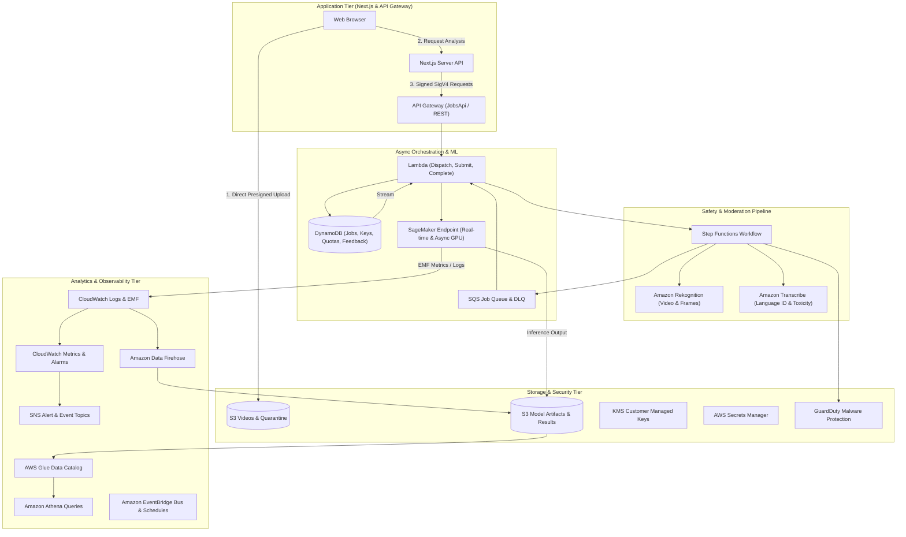

# Comprehensive AWS Services Architecture & Inventory Report: VideoSaaS

## Executive Summary

The **VideoSaaS** project (also branded as **Aspect Sentiment**) is a multimodal video emotion and sentiment analysis platform. It combines computer vision (video frames via 3D ResNet / R3D-18), speech audio processing (mel-spectrograms), and natural language processing (automatic speech recognition via Whisper and textual classification via BERT).

The AWS footprint spans three execution tiers:
1. **Frontend & Application API**: Next.js App Router using the `@aws-sdk` (S3, DynamoDB, SageMaker Runtime) and `@smithy/signature-v4` for IAM-authenticated SigV4 communication.
2. **Machine Learning Pipeline**: Amazon SageMaker custom containers for model training, real-time GPU inference, asynchronous processing, and automated quality/drift capture.
3. **Data Platform, Guardrails & Monitoring Infrastructure (AWS CDK)**: A full production-grade cloud infrastructure defined in Python AWS CDK covering asynchronous task dispatching, content moderation, automated threat detection, analytics, and operational monitoring.

All regional resources are targeted for the project's **selected Region: `ap-southeast-2` (Sydney)**.

---

## Architecture Flow Overview

---

## Detailed Service Catalog by Functional Domain

### 1. Artificial Intelligence & Machine Learning

#### 1.1 Amazon SageMaker AI
- **SageMaker Model Training**:
  - **Role**: Distributed model training of the multimodal PyTorch fusion model on the MELD dataset.
  - **Compute Instance**: `ml.g5.xlarge` (NVIDIA A10G GPU).
  - **Implementation**: [train_sagemaker.py](file:///c:/Users/aamod/OneDrive/Desktop/Apps/VideoSaaS/services/inference/train_sagemaker.py) uses the SageMaker Python SDK `PyTorch` estimator and `TensorBoardOutputConfig` to write checkpoints and logs to S3.
- **SageMaker Real-Time Endpoint**:
  - **Role**: Synchronous inference endpoint (`sentiment-analysis-endpoint`) serving multimodal predictions. Runs PyTorch 2.5.1 with FFmpeg audio extraction, Whisper speech segmentation, and neural feature fusion.
  - **Implementation**: [deploy_endpoint.py](file:///c:/Users/aamod/OneDrive/Desktop/Apps/VideoSaaS/services/inference/deployment/deploy_endpoint.py) and [inference.py](file:///c:/Users/aamod/OneDrive/Desktop/Apps/VideoSaaS/services/inference/deployment/inference.py).
  - **Current Status**: Actively ran and was subsequently deleted during the 15 November 2026 cost cleanup to eliminate the **\$1.8312/hour (\$1,336.78/month)** idle compute charge. The endpoint config (`sentiment-analysis-endpoint-media-compat`), model registration, and S3 archive are preserved for rapid restoration.
- **SageMaker Asynchronous Inference**:
  - **Role**: Long-running video job execution with scale-to-zero capabilities.
  - **Implementation**: Defined in CDK [data_pipeline.py](file:///c:/Users/aamod/OneDrive/Desktop/Apps/VideoSaaS/services/inference/monitoring/data_pipeline.py#L183-L238) (`CfnEndpointConfig.AsyncInferenceConfigProperty`). Handles output delivery to S3 and publishes completion notifications to SNS.
- **SageMaker Studio & Notebooks**:
  - **Role**: Interactive ML development and model tuning.
  - **Retained Resources**: Studio domain in `ap-southeast-2` with a 5 GB gp3 EBS volume attached to a stopped JupyterLab space. Idle timeout defaults were reduced to 60 minutes.
- **SageMaker Model Monitor / Data Capture**:
  - **Role**: Samples 5% of incoming request payloads to S3 (`destination_s3_uri`) to power automated drift calculations.

#### 1.2 Amazon Rekognition
- **Role**: Visual content safety and moderation on uploaded videos.
- **Implementation**: Invoked in the moderation Lambda [moderate.py](file:///c:/Users/aamod/OneDrive/Desktop/Apps/VideoSaaS/services/inference/monitoring/runtime/moderate.py#L39-L114):
  - `DetectModerationLabels`: Fast inspection of 6 sampled video frames.
  - `StartContentModeration` & `GetContentModeration`: Borderline scores trigger full asynchronous video moderation across all frames to detect prohibited imagery.

#### 1.3 Amazon Transcribe
- **Role**: Speech safety and toxicity evaluation on the video audio track.
- **Implementation**: Managed in [moderate.py](file:///c:/Users/aamod/OneDrive/Desktop/Apps/VideoSaaS/services/inference/monitoring/runtime/moderate.py#L86-L130):
  - **Language Identification**: Executes batch transcription jobs (`language-*`) to verify spoken language.
  - **Toxicity Detection**: For confidently identified US English audio, runs toxicity detection (`moderation-*`) to screen for profanity, harassment, and hate speech.

---

### 2. Object Storage & Delivery

#### 2.1 Amazon Simple Storage Service (S3)
- **Role**: Primary data store for datasets, model artifacts, video uploads, quarantine staging, analytical logs, and inference outputs.
- **Bucket Layout & Configurations**:
  - `aspect-sentiment-lab`: Active lab bucket holding `dataset/`, `models/`, `training-output/`, `code/`, and `tensorboard/` (~17,612 objects / ~15.03 GiB). Configured with a bucket-wide 7-day abort rule for incomplete multipart uploads.
  - `Videos` Bucket (CDK): Encrypted private bucket for verified uploads with 7-day lifecycle expiration and CORS policies.
  - `Quarantine` Bucket (CDK): Version-controlled staging bucket for unverified uploads; pending objects expire after 2 days; blocked uploads handled via safety policy.
  - `Artifacts` Bucket (CDK): Houses model weights (`model.tar.gz`) encrypted with KMS.
  - `Results`, `Capture`, `Lake`, & `MonitoringData` Buckets (CDK): Store async outputs, captured payloads, columnar Parquet data lake files, and Firehose log archives.
- **Application Code**: Presigned upload URL generation in [upload-url/route.ts](file:///c:/Users/aamod/OneDrive/Desktop/Apps/VideoSaaS/apps/app/src/app/api/upload-url/route.ts) using `@aws-sdk/s3-request-presigner` and `@aws-sdk/client-s3`.

---

### 3. Databases, Caching & Data Management

#### 3.1 Amazon DynamoDB
- **Role**: Authoritative fast-path datastore for asynchronous job lifecycles, user feedback, API key digests, and monthly usage quotas.
- **Tables Defined & Used**:
  - `FeedbackTable`: Stores prediction feedback (`feedback#...`) and hourly accuracy counters (`acc#...`) using atomic `TransactWriteItems` ([feedback/route.ts](file:///c:/Users/aamod/OneDrive/Desktop/Apps/VideoSaaS/apps/app/src/app/api/feedback/route.ts) and [app.py](file:///c:/Users/aamod/OneDrive/Desktop/Apps/VideoSaaS/services/inference/monitoring/app.py#L215-L220)).
  - `ApiKeys`: Stores SHA-256 hashed API keys, mapped tenants, and expiration timestamps ([guardrails.ts](file:///c:/Users/aamod/OneDrive/Desktop/Apps/VideoSaaS/apps/app/src/lib/guardrails.ts)).
  - `QuotaCounters`: Tracks monthly tenant request quotas via atomic transactions.
  - `InferenceJobs`: Tracks async job states (`QUEUED`, `PENDING_MODERATION`, `PROCESSING`, `COMPLETED`, `FAILED`) with **DynamoDB Streams** (`NEW_IMAGE`) and GSIs (`ByUser`, `ByJob`, `ByReviewTenant`).
- **Features**: Pay-Per-Request billing, Point-in-Time Recovery (PITR), customer-managed KMS encryption, and TTL attributes.

#### 3.2 Amazon Aurora PostgreSQL Serverless v2 (Optional Production Tier)
- **Role**: Multi-tenant relational database storing organizations, memberships, subscription tiers, moderation audit history, and strike tracking.
- **Implementation**: Defined in CDK [data_architecture.py](file:///c:/Users/aamod/OneDrive/Desktop/Apps/VideoSaaS/services/inference/monitoring/data_architecture.py#L108-L123):
  - Serverless v2 writer (0.5 to 16 ACUs) with an automated failover reader.
  - Forced SSL (`rds.force_ssl = 1`), deletion protection, 35-day backup retention, and row-level security schemas (`001_tenants.sql`, `002_strikes.sql`).
- **AWS RDS Data API**: Enabled (`enable_data_api=True`) so Lambda functions execute SQL statements over HTTP via [safety_store.py](file:///c:/Users/aamod/OneDrive/Desktop/Apps/VideoSaaS/services/inference/monitoring/runtime/safety_store.py) without exhausting database connection pools.

#### 3.3 Amazon RDS Proxy
- **Role**: TLS-enforced connection pooling proxy between compute workloads and Aurora PostgreSQL ([data_architecture.py](file:///c:/Users/aamod/OneDrive/Desktop/Apps/VideoSaaS/services/inference/monitoring/data_architecture.py#L136-L137)).

#### 3.4 Amazon ElastiCache (Valkey Serverless)
- **Role**: Sub-millisecond in-memory cache running the open-source **Valkey** engine.
- **Implementation**: Defined in CDK [data_architecture.py](file:///c:/Users/aamod/OneDrive/Desktop/Apps/VideoSaaS/services/inference/monitoring/data_architecture.py#L154-L160) (`CfnServerlessCache`) to perform rate limiting and quota pre-checks with automatic fallback to DynamoDB.

---

### 4. Serverless Compute & Workflow Orchestration

#### 4.1 AWS Lambda
- **Role**: Microservice execution layer across telemetry normalization, drift detection, job dispatching, and content moderation (Python 3.12 runtime).
- **Functions Implemented**:
  1. `Normalize` ([delivery.py](file:///c:/Users/aamod/OneDrive/Desktop/Apps/VideoSaaS/services/inference/monitoring/runtime/delivery.py)): Firehose processor transforming raw TorchServe log records into structured NDJSON.
  2. `Drift` ([drift.py](file:///c:/Users/aamod/OneDrive/Desktop/Apps/VideoSaaS/services/inference/monitoring/runtime/drift.py)): Hourly job computing Population Stability Index (PSI) and embedding shift against baseline distributions.
  3. `Accuracy` ([accuracy.py](file:///c:/Users/aamod/OneDrive/Desktop/Apps/VideoSaaS/services/inference/monitoring/runtime/accuracy.py)): Hourly job aggregating feedback accuracy counters from DynamoDB.
  4. `DataJobsApi` ([data_jobs.py](file:///c:/Users/aamod/OneDrive/Desktop/Apps/VideoSaaS/services/inference/monitoring/runtime/data_jobs.py)): REST API handler for uploads, job submissions, status polling, and quota queries.
  5. `DataDispatch` ([data_jobs.py](file:///c:/Users/aamod/OneDrive/Desktop/Apps/VideoSaaS/services/inference/monitoring/runtime/data_jobs.py)): DynamoDB Stream listener routing new jobs to SQS or Step Functions.
  6. `DataWorker` ([data_jobs.py](file:///c:/Users/aamod/OneDrive/Desktop/Apps/VideoSaaS/services/inference/monitoring/runtime/data_jobs.py)): SQS consumer submitting cleared jobs to SageMaker Async endpoints.
  7. `DataCompletion` & `DataResultBridge` ([data_jobs.py](file:///c:/Users/aamod/OneDrive/Desktop/Apps/VideoSaaS/services/inference/monitoring/runtime/data_jobs.py)): Processes completion events from SNS/EventBridge and updates job records.
  8. `ModerationScan`, `ModerationStart`, `ModerationPoll`, `ModerationFinish` ([moderate.py](file:///c:/Users/aamod/OneDrive/Desktop/Apps/VideoSaaS/services/inference/monitoring/runtime/moderate.py)): Four-stage safety verification pipeline (uses a custom FFmpeg/FFprobe Lambda Layer).
  9. `ModerationReviewer`: Human-in-the-loop review queue and approval/rejection endpoint.
  10. `EraseSubject` ([erase_subject.py](file:///c:/Users/aamod/OneDrive/Desktop/Apps/VideoSaaS/services/inference/monitoring/runtime/erase_subject.py)): Executes subject data deletion across S3 and DynamoDB.

#### 4.2 AWS Step Functions
- **Role**: Stateful orchestration of the content moderation pipeline.
- **Implementation**: Defined in [moderation.py](file:///c:/Users/aamod/OneDrive/Desktop/Apps/VideoSaaS/services/inference/monitoring/moderation.py) and [moderation_states.py](file:///c:/Users/aamod/OneDrive/Desktop/Apps/VideoSaaS/services/inference/monitoring/runtime/moderation_states.py). Coordinates MP4 container checks, Rekognition frame/video moderation, Transcribe toxicity analysis, policy decisions (`PASS`/`REVIEW`/`BLOCK`), and cleanup.

---

### 5. Messaging, Streaming & Event Orchestration

#### 5.1 Amazon SQS (Simple Queue Service)
- **Role**: Decoupled asynchronous job buffering and failure capture.
- **Queues**:
  - `SubmitQueue`: KMS-encrypted queue buffering jobs before SageMaker invocation (6-minute visibility timeout).
  - `DeadLetters` (DLQ): 14-day retention queue capturing failed stream batches, SQS retries, Lambda async failures, and EventBridge delivery failures.

#### 5.2 Amazon SNS (Simple Notification Service)
- **Role**: Event broadcasting and operational alerting.
- **Topics**:
  - `Alerts`: Receives CloudWatch composite alarm notifications with optional email subscriptions ([app.py](file:///c:/Users/aamod/OneDrive/Desktop/Apps/VideoSaaS/services/inference/monitoring/app.py#L268-L272)).
  - `CompletionNotifications`: Publishes finished async inference results (KMS-encrypted).
  - `ModelEvents`: Receives SageMaker Async success and failure callbacks (SSL enforced).

#### 5.3 Amazon EventBridge
- **Role**: Custom event routing and scheduled cron jobs.
- **Components**:
  - Custom Event Bus (`ModelResults`): Routes bridged SageMaker inference results to `DataCompletion` Lambda.
  - Scheduled Rules: Runs `DriftSchedule` (hourly at minute :12) and `AccuracySchedule` (hourly at minute :20).
  - GuardDuty Integration: Managed event rules for S3 malware scan verdicts.

#### 5.4 Amazon Data Firehose
- **Role**: Near-real-time streaming delivery of inference logs to S3.
- **Implementation**: Receives log events via CloudWatch Logs Subscription Filter (`DirectPut`), invokes the `Normalize` Lambda, and writes GZIP-compressed partitions (`events/dt=YYYY-MM-DD/hour=HH/`) to S3 ([app.py](file:///c:/Users/aamod/OneDrive/Desktop/Apps/VideoSaaS/services/inference/monitoring/app.py#L132-L147)).

---

### 6. Networking & API Management

#### 6.1 Amazon API Gateway
- **REST API (`JobsApi`)**:
  - **Role**: IAM-authenticated API managing guarded uploads, async job creation/polling, quota reads, and restricted reviewer endpoints (`/review/{tenant}/{jobId}`).
  - **Caller**: [async-inference/[[...operation]]/route.ts](file:///c:/Users/aamod/OneDrive/Desktop/Apps/VideoSaaS/apps/app/src/app/api/async-inference/[[...operation]]/route.ts) signs requests with `@smithy/signature-v4`.
- **HTTP API (Legacy)**: An earlier test HTTP API (`first-web-app`) was recorded in the project audit with zero always-on cost.

#### 6.2 Amazon VPC & AWS PrivateLink (VPC Endpoints)
- **Role**: Network isolation for Aurora, Valkey, and VPC-attached Lambdas across two Availability Zones (`ap-southeast-2a`, `ap-southeast-2b`).
- **Configuration**: Private isolated subnets with **zero NAT Gateways** to avoid hourly NAT fees.
- **VPC Endpoints**:
  - **Gateway Endpoints** (no hourly fee): Amazon S3, Amazon DynamoDB.
  - **Interface Endpoints (PrivateLink)**: AWS Secrets Manager, Amazon SQS, SageMaker Runtime, AWS RDS Data API.

---

### 7. Security, Identity & Threat Protection

#### 7.1 AWS Identity and Access Management (IAM)
- **Role**: Least-privilege access control across services and roles.
- **Key Roles**: `EndpointRole`, `ModelExecutionRole`, `FirehoseRole`, `LogsDeliveryRole`, `SaasRole`, `ReviewCaller` (enforced via API Gateway Deny resource policy), `MalwareScanRole`, and per-function Lambda execution roles.

#### 7.2 AWS Key Management Service (KMS)
- **Role**: Cryptographic isolation across data tiers.
- **Implementation**: Separate Customer Managed Keys (CMKs) with automatic annual rotation for every S3 bucket, DynamoDB table, SQS queue, SNS topic, Aurora cluster, Valkey cache, and Secrets Manager secret. The current lab S3 bucket uses default AWS-managed encryption.

#### 7.3 AWS Secrets Manager
- **Role**: Automated storage and 30-day rotation of database admin (`dbadmin`), application (`aspect_app`), and safety (`aspect_safety`) credentials.

#### 7.4 Amazon GuardDuty
- **Role**: Automated malware scanning on user uploads.
- **Implementation**: `CfnMalwareProtectionPlan` ([moderation.py](file:///c:/Users/aamod/OneDrive/Desktop/Apps/VideoSaaS/services/inference/monitoring/moderation.py#L39-L46)) scans objects in the Quarantine bucket's `uploads/` prefix and tags verdicts directly on object versions.

---

### 8. Analytics & Data Lake

#### 8.1 AWS Glue Data Catalog
- **Role**: Schema registry and partition projection metadata for serverless SQL analytics.
- **Databases & Tables**:
  - `video_sentiment_monitoring` → `inference_events` (JSON SerDe, partitioned by `dt`, `hour`).
  - `aspect_sentiment_lake` → `usage`, `accuracy`, `drift` (Parquet format, partitioned by `dt`, `tenant_id`).

#### 8.2 Amazon Athena
- **Role**: Serverless SQL engine querying telemetry and lake datasets in S3.
- **Implementation**:
  - Workgroups: `video-sentiment-monitoring`, `Operations` (10 GiB scan cap), and `Reporting` (25 GiB scan cap) with encrypted result locations and pre-built SQL views ([lake_views.sql](file:///c:/Users/aamod/OneDrive/Desktop/Apps/VideoSaaS/services/inference/monitoring/sql/lake_views.sql)).

---

### 9. Observability, Scaling, Containers & Infrastructure

#### 9.1 Amazon CloudWatch
- **CloudWatch Logs**: Stores SageMaker endpoint logs, training logs, Studio logs, Lambda logs, and Firehose logs (retention bounded at 30 days for endpoints/apps and 90 days for training/Studio).
- **CloudWatch Embedded Metric Format (EMF)**: Emits multidimensional metrics (`VideoSentiment/Inference`, `VideoSentiment/Monitoring`) directly via structured stdout logs ([telemetry.py](file:///c:/Users/aamod/OneDrive/Desktop/Apps/VideoSaaS/services/inference/deployment/telemetry.py#L110-L124)).
- **CloudWatch Alarms & Composite Alarms**: Monitors 5XX error rates, throttles, p95/p99 latency, GPU memory, drift scores, OOD rates, moderation blocks, and DLQ depth, rolled up into `Serving`, `Quality`, and `Pipeline` composite alarms.
- **CloudWatch Dashboards**: `{endpoint}-monitoring` dashboard visualizing traffic, latency, GPU load, emotion/sentiment class distributions, accuracy, and pipeline stage timings.

#### 9.2 Application Auto Scaling
- **Real-Time Target Tracking**: Scales SageMaker variants on `InvocationsPerInstance`.
- **Async Scale-to-Zero**: Scales on `ApproximateBacklogSizePerInstance` and wakes from 0 instances using `HasBacklogWithoutCapacity`.

#### 9.3 Amazon Elastic Container Registry (ECR)
- **Role**: References AWS Deep Learning Containers (`pytorch-inference`) and maintains a private repository in `ap-southeast-2` for custom container images.

#### 9.4 AWS CloudFormation & AWS CDK
- **Role**: Infrastructure as Code defining the entire monitoring, data architecture, async pipeline, and moderation stacks ([app.py](file:///c:/Users/aamod/OneDrive/Desktop/Apps/VideoSaaS/services/inference/monitoring/app.py), [cdk.json](file:///c:/Users/aamod/OneDrive/Desktop/Apps/VideoSaaS/services/inference/monitoring/cdk.json)).

#### 9.5 Amazon EC2 & EBS
- **EC2 / EBS**: Historical `c7i-flex.large` compute and gp3 volumes appeared in the October 2026 billing ledger during early prototyping; no live EC2 instances remain.

---

## Master AWS Services Inventory Matrix

| Service | Category | Primary Codebase References | Current Status in AWS Project (`ap-southeast-2`) |
| :--- | :--- | :--- | :--- |
| **Amazon SageMaker AI** | AI & ML | `train_sagemaker.py`, `deploy_endpoint.py`, `inference.py`, `data_pipeline.py` | Models, configs & Studio disk preserved; real-time GPU endpoint deleted to stop idle cost |
| **Amazon Rekognition** | AI & ML | `monitoring/runtime/moderate.py`, `monitoring/moderation.py` | Implemented in CDK & runtime (not yet deployed) |
| **Amazon Transcribe** | AI & ML | `monitoring/runtime/moderate.py`, `monitoring/moderation.py` | Implemented in CDK & runtime (requires Paid plan in this AWS experience) |
| **Amazon S3** | Storage | `upload-url/route.ts`, `train_sagemaker.py`, CDK stacks | Active lab bucket (`aspect-sentiment-lab`, ~15.03 GiB); CDK buckets undeployed |
| **Amazon DynamoDB** | Database | `guardrails.ts`, `feedback/route.ts`, `data_jobs.py`, CDK stacks | Active SDK integration; tables defined in CDK (undeployed) |
| **Amazon Aurora PostgreSQL** | Database | `monitoring/data_architecture.py`, `sql/001_tenants.sql`, `002_strikes.sql` | Defined in optional CDK data architecture (undeployed) |
| **Amazon RDS Proxy** | Database | `monitoring/data_architecture.py` | Defined in optional CDK data architecture (undeployed) |
| **AWS RDS Data API** | Database | `monitoring/runtime/safety_store.py`, `data_architecture.py` | Defined in CDK & safety store runtime (undeployed) |
| **Amazon ElastiCache (Valkey)** | Cache | `monitoring/data_architecture.py` | Defined in optional CDK data architecture (undeployed) |
| **AWS Lambda** | Compute | `monitoring/runtime/*.py`, `app.py`, `data_pipeline.py`, `moderation.py` | 10+ Python handlers defined in CDK (undeployed) |
| **AWS Step Functions** | Orchestration | `monitoring/moderation.py`, `runtime/moderation_states.py` | Moderation state machine defined in CDK (undeployed) |
| **Amazon SQS** | Messaging | `monitoring/data_pipeline.py`, `runtime/data_jobs.py` | `SubmitQueue` & `DeadLetters` defined in CDK (undeployed) |
| **Amazon SNS** | Messaging | `monitoring/app.py`, `data_pipeline.py` | `Alerts`, `ModelEvents`, `CompletionNotifications` in CDK (undeployed) |
| **Amazon EventBridge** | Event Routing | `monitoring/app.py`, `data_pipeline.py`, `moderation.py` | Custom bus & hourly cron rules defined in CDK (undeployed) |
| **Amazon Data Firehose** | Streaming | `monitoring/app.py`, `runtime/delivery.py` | Log-to-S3 stream defined in CDK (requires Paid plan in this AWS experience) |
| **Amazon API Gateway** | Networking | `async-inference/route.ts`, `monitoring/data_pipeline.py` | Legacy HTTP API present; production REST `JobsApi` defined in CDK (undeployed) |
| **Amazon VPC & PrivateLink** | Networking | `monitoring/data_architecture.py` | Default VPC present; isolated dual-AZ VPC & endpoints in CDK (undeployed) |
| **AWS IAM** | Security | CDK stacks, Next.js SigV4 signing | Active execution roles present; least-privilege CDK policies defined |
| **AWS KMS** | Security | `monitoring/data_architecture.py` | 1 AWS-managed S3 key active; 12+ CMKs defined in CDK (undeployed) |
| **AWS Secrets Manager** | Security | `monitoring/data_architecture.py` | Historical API usage recorded; DB rotation secrets in CDK (undeployed) |
| **Amazon GuardDuty** | Security | `monitoring/moderation.py` | S3 Malware Protection defined in CDK (requires advanced features) |
| **AWS Glue Data Catalog** | Analytics | `monitoring/app.py`, `data_architecture.py` | External table catalogs defined in CDK (undeployed) |
| **Amazon Athena** | Analytics | `monitoring/app.py`, `data_architecture.py`, `sql/lake_views.sql` | Default workgroup present; custom workgroups & views in CDK (undeployed) |
| **Amazon CloudWatch** | Observability | `deployment/telemetry.py`, `monitoring/app.py` | 4 bounded Sydney log groups active; alarms & dashboard in CDK (undeployed) |
| **Application Auto Scaling** | Scaling | `monitoring/app.py`, `data_pipeline.py` | Real-time & async scale-to-zero policies in CDK (undeployed) |
| **Amazon ECR** | Containers | `monitoring/app.py`, `data_pipeline.py` | Empty private repository present + AWS DLC references |
| **AWS CDK / CloudFormation** | IaC | `services/inference/monitoring/` | Defines all optional monitoring, async, and moderation stacks |
| **Amazon EC2 & EBS** | Compute/Disk | Historical prototyping & Studio storage | 0 live EC2 instances; 5 GB Studio gp3 EBS volume retained |

---

## Live Project Cost & Plan Notes

Based on the **15 November 2026** audit ([aws-cost-analysis-2026-11-15.md](file:///c:/Users/aamod/OneDrive/Desktop/Apps/VideoSaaS/docs/reports/aws-cost-analysis-2026-11-15.md)) and subsequent cleanup ([aws-cost-reductions-2026-11-15.md](file:///c:/Users/aamod/OneDrive/Desktop/Apps/VideoSaaS/docs/reports/aws-cost-reductions-2026-11-15.md)) for project **console dot dream**:

- **Cost Reduction Achieved**: Removing the running `sentiment-analysis-endpoint` (`ml.g5.xlarge`) dropped the known monthly baseline from **\$1,337.83/month** to **~\$1.05/month** (~\$0.38 for S3 data/models, ~\$0.67 for the stopped 5 GB Studio volume, and ~\$0.0003 for CloudWatch logs).
- **Plan & Service Availability**: The project is on the **Free plan** (checkable in **AWS Settings → Billing**). Several optional CDK services—specifically **Amazon Data Firehose**, **Amazon Transcribe**, and **Amazon GuardDuty Malware Protection**—require upgrading to the Paid plan or activating advanced features before deployment.
- **Restoring Live Inference**: The trained model artifact (`s3://aspect-sentiment-lab/inference/sentiment-analysis-model-media-compat/model.tar.gz`) and endpoint configuration remain intact, allowing live real-time inference to be restored on demand without retraining.
