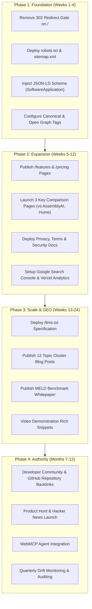

# Implementation Roadmap: 4-Phase SaaS SEO Execution

**Project:** Aspect Sentiment (Nuance)  
**Target URL:** `https://nuance-xi.vercel.app/`

---

---

## Deliverables & Success Metrics by Phase

### Phase 1: Foundation (Weeks 1–4)
- **Goal:** Unblock search engine indexing and establish valid entity schema.
- **Milestones:**
  - `GET /` returns `200 OK` with semantic homepage HTML.
  - `/robots.txt` and `/sitemap.xml` return `200 OK`.
  - Schema.org Rich Results Test passes with 0 errors for `SoftwareApplication`.
  - Social media cards render properly with branded preview image.
- **KPI:** Googlebot crawl frequency > 50 pages/day in Google Search Console.

### Phase 2: Expansion (Weeks 5–12)
- **Goal:** Capture high-intent transactional and comparison queries.
- **Milestones:**
  - Launch `/features`, `/pricing`, `/solutions`, `/compare`.
  - Comparison pages rank on Page 1 for branded alternative searches.
  - User session conversion rate from organic visitors to `/signup` > 3.5%.
- **KPI:** 1,000+ organic monthly impressions across branded & alternative keywords.

### Phase 3: Scale & Generative Engine Optimization (Weeks 13–24)
- **Goal:** Secure citations in AI Search engines (Perplexity, ChatGPT, Gemini, Google AI Overviews).
- **Milestones:**
  - Host `/llms.txt` and structured answer passages.
  - Publish original benchmark data on video emotion accuracy.
- **KPI:** Cited in at least 3 major LLM search engines for multimodal sentiment queries.

### Phase 4: Authority & Automation (Months 7–12)
- **Goal:** Market dominance and automated agent tool readiness.
- **Milestones:**
  - Expose WebMCP tools for autonomous agents to submit video analyses.
  - Continuous regression prevention via automated `/seo drift` audits.
- **KPI:** 15,000+ monthly organic visitors and Domain Rating > 35.
